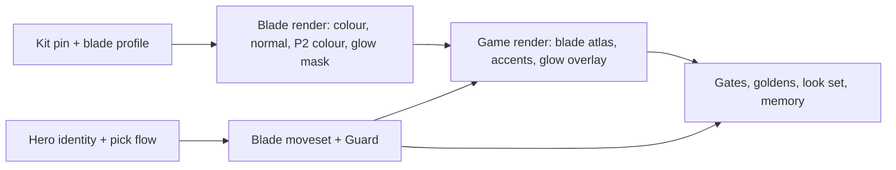

# feat: Blade fighter, a second playable hero

## Overview

Add a second playable hero to `games/nr`. She is a female blade fighter on the pinned Superhero_Female body, with a generated sword that glows through an additive mask, and she plays in both player accents. Any player can join at any time and pick a hero; the first to confirm a hero locks it. She uses the brawler's controls with a longer sword combo, a dash strike, and Guard on the Grab button.

## Problem Frame

The combat slice has one hero, so co-op players are told apart only by accent and there is nothing to pick. The pipeline, sim and gates are proven for one hero. This plan adds a second character with a different feel, without moving the brawler's proven runs (see origin: docs/brainstorms/2026-10-25-blade-hero-requirements.md).

## Requirements Trace

- R1–R5. Join and pick at any time; first confirm locks the hero; solo plays either; disconnect keeps the hero; title return unlocks all.
- R6–R11. Sword combo with longer reach and duration; dash strike; Guard on held Grab with the stated block, flinch, facing and invulnerability rules; the two shared upgrade specials drawn with sword clips; everything else as the brawler.
- R12–R16. Superhero_Female body with a neon retexture; generated sword in hand in every clip; additive blade glow in the player's accent; per-player accents on both heroes; HUD names each hero.
- R17–R18. A two-hero brawler-gate run on every host; blade look captures under one light, mid-combo beside a grunt, and guarding.

## Scope Boundaries

- No blade-specific upgrades, no grab or throw for her, no hand-keyed clips, no duplicate heroes, no new enemies, arenas or waves, no enemy behaviour against Guard (see origin).
- The polish backlog from the owner's playtest (knockback reactions on enemies, special HUD) stays out of this plan.

## Context & Research

### Relevant Code and Patterns

- Sim: `games/nr/sim.c` `DEF[NR_ST_COUNT]` state table (rows parsed by `sim-check.mjs`, `enemies-check.mjs`, `fx-lib.mjs` in the exact `[NR_ST_X] = { { "name", t, s, a }` form); grunt and heavy already own appended swing states. `hero_free` maps edges to HIT1, GRAB and DASH. `apply_hit` turns the victim, sets HURT/KNOCKDOWN and hero invulnerability; `resolve_hits` checks `SKIP_INVULN` first. `checksum_of` has four zero pad slots in `n[]` and an `ex[]` block hashed only when `!auto_presence`.
- Title and join: `join_player`, `start_presses`, `title_step`; `upgrade_step` is an existing per-player tap pick with lower-port tie break. `set_away` keeps `present` through a disconnect. `restart_to_title` re-inits the sim, which unlocks heroes for free.
- Input: `nr_input` carries `grab` as an edge only; `input_from_mask` and `read_input` in `games/nr/main.c` both build it.
- Render: `games/nr/main.c` `CHARS`, `VIS_HERO/GRUNT/HEAVY`, `char_of(kind)`, `build_scene` (P2 accent via `S.hero_p2`), FX ring block (additive `basic`, `depth_write` off, order −8, outside checksum). `games/nr/anim.c` `nr_atlas_variant` shares geometry and normals for an accent sheet; loader allows one page per character.
- Pipeline: `tools/render/nr_render.py` albedo and normal passes, `normal_override_material` as the template for a mask pass, rigid primitive attachments skinned to a bone, `paletteOverride` for accent recipes; `tools/render/post.mjs` sheet roles, `verifyRects`; `tools/render/kits.mjs` pins by basename.
- Gates: `games/nr/tests/brawler.mjs` scripts and `FIELDS`, `goldens.mjs`, the gen-input scripts, `ui-check.mjs`, `title-contrast-check.mjs`, `look-set.mjs`, `reach-check.mjs`, `clips-check.mjs`, `hero-variant-check.mjs`, `depth-check.mjs`, `controls.mjs`, `tests/gates.json` nr entries (10 copied field lists).
- Memory: SDK `cmake/app.cmake` sets 128 MiB initial and 1 GiB maximum; hosts allow growth to the declared maximum. `perf-carts.mjs` measures touched pages.

### Institutional Learnings

- macOS runner settings and the romdev frame-1 offset apply to every new script (`docs/solutions/developer-experience/cartwheel-runners-on-macos-env-2026-10-24.md`, `docs/solutions/logic-errors/romdev-loadmedia-consumes-frame-one-2026-10-24.md`).
- A new material state needs a program survey, committed tables, `cw.three.missing == 0`, and a row-removal control (`docs/solutions/workflow-issues/cartwheel-programs-survey-out-of-tree-2026-10-24.md`).
- Atlas contract: binary alpha, matching colour/normal rects, accents as a second colour sheet over shared geometry (ADR-0002).
- Effects stay deterministic and outside the checksum; additive draws need explicit order and depth rules with a wrong-order control (ADR-0002 Round 4).
- Captures assert phase and state before keeping the image; GL and WebGPU compare only against their own API (look README, ADR-0002).

## Prior-Art Survey

```json
{
  "schema_version": 2,
  "verdict": "extend",
  "scope": "games/**, deps/cartwheel-engine/games/**, /tmp/cartwheel-examples/games/**",
  "freshness": { "vcs_reference": "dc61d75" },
  "budget": { "max_search_passes": 6, "max_candidate_inspections": 12, "exhausted": false },
  "candidates": [
    { "path_or_symbol": "games/nr/sim.c:ENEMY[] and DEF[]", "description": "per-kind enemy numbers and per-state hitbox/timing rows; grunt and heavy own appended swing states", "disposition": "extend" },
    { "path_or_symbol": "games/nr/main.c:VIS_HERO/VIS_GRUNT/VIS_HEAVY, char_of, CHARS", "description": "per-character state-to-clip tables and atlas selection", "disposition": "extend" },
    { "path_or_symbol": "games/nr/anim.c:nr_atlas_variant", "description": "per-player accent as a second colour sheet over shared geometry and normals", "disposition": "reuse" },
    { "path_or_symbol": "games/nr/sim.c:join_player, start_presses, title_step, upgrade_step", "description": "per-player join and a per-player tap pick with lower-port tie break", "disposition": "extend" },
    { "path_or_symbol": "games/nr/main.c:bot_menu and games/nr/ui.c:draw_title, draw_tag", "description": "scripted menu joins, title panels, HUD tags", "disposition": "extend" },
    { "path_or_symbol": "games/nr/sim.h:nr_input.special_alt", "description": "the only held-button input; no held defensive state exists", "disposition": "insufficient", "insufficiency_reason": "Guard needs a held Grab field and a new state" },
    { "path_or_symbol": "/tmp/cartwheel-examples/games/bikemesa/main.c:players_tick", "description": "per-player select slots outside a checksummed sim", "disposition": "insufficient", "insufficiency_reason": "UI-layer state; a pattern reference only" }
  ]
}
```

## Key Technical Decisions

- **Hero identity:** a `hero` field on the actor (0 brawler, 1 blade), hashed in an `n[]` pad slot so a brawler hashes as before. Select state (cursor, lock mask, selecting flags) lives in `ex[]`, hashed only with the title flow. Brawler-only runs stay byte-identical.
- **Moveset as appended states** (blade hits, dash strike, guard, guard flinch) in the existing `DEF` row format, the pattern grunt and heavy use. Existing state numbers and test parsers stay valid. `hero_free` picks the hero's entry states.
- **Held Grab:** `nr_input` gains a held-grab field built in both `input_from_mask` and `read_input`; the edge stays for the brawler.
- **Guard rules (from origin, plus one planning answer):** frontal means the attacker is on her facing side. A frontal hit while guarding or in the guard flinch costs no HP, does not turn her, grants no invulnerability, and pushes her back further for the heavy. The flinch returns to Guard while Grab is held, else to idle. A rear hit falls through to the normal `apply_hit`.
- **Camera margin per hero:** each actor's allowance comes from its hero's widest frame, so her reach widens only her margin. Arena block widening keeps its reach from the brawler atlas, so pillar goldens don't move.
- **Pick flow:** Start joins with a cursor on the first free hero; tap moves it; Attack confirms and locks. A locked hero cannot be confirmed by another player; the first confirm wins and the lower port wins a same-tick tie. Start from a confirmed player begins the fight at the title. A mid-fight joiner picks while the fight runs and spawns at the camera edge on confirm. A title-only rule drops a player who disconnects before confirming.
- **Glow:** a fourth sheet role, a white blade mask rendered by a mask pass in `nr_render.py`, packed with the same rects. In game it is an additive textured `basic` material on the blade's frame geometry, tinted by the player's accent, depth write off, at its own explicit order relative to the actor. This adds program rows; survey and commit tables.
- **Accents:** both heroes ship a P2 colour sheet via `nr_atlas_variant`; the glow mask is accent-neutral and tinted at draw time.
- **Memory:** the 64 MiB atlas budget is retired. The three budget checks are replaced by a measured touched-memory report; the cart grows past its 128 MiB initial size up to 1 GiB, and an explicit initial size is set only if the measured peak makes growth hitch.
- **Kit tool:** `kits.mjs` refuses ambiguous basenames with a message naming the candidate paths and a `--prefer <path fragment>` option to choose one.

## Open Questions

### Resolved During Planning

- Body: Superhero_Female_FullBody is pinned (160b521) with Eyebrows_Female, Hair_Buns and Hair_BuzzedFemale from the head-bone variant.
- Confirm button: Attack.
- Frontal hit during the guard flinch: blocked while Grab is held.

### Deferred to Implementation

- Which hand bone holds the sword, and the profile's `handScale` for her (the sword scales with the hand).
- Her cell size: start at 160 with the brawler's pivot; widen only her atlas if the sword leaves the cell.
- Which kit clips draw her walk, hurt and knockdown, and which sword clip segments draw her two specials (from the clip audit).
- Starting values for combo reach and timing and Guard pushback.
- Whether the glow mask needs a second program row on WebGPU or GL only.

## High-Level Technical Design

> *This illustrates the intended approach and is directional guidance for review, not implementation specification. The implementing agent should treat it as context, not code to reproduce.*



Two lanes run in parallel: the render lane (Units 1, 2, 6) and the sim lane (Units 3, 4). Unit 5 joins them; Unit 7 closes.

## Implementation Units

- [ ] **Unit 1: Kit tool fix and blade profile with first clips**

**Goal:** Fix the ambiguous-basename pin, add the blade profile with the generated sword, and render idle and walk in both accents.

**Requirements:** R12, R13, R15

**Dependencies:** none

**Files:**
- Modify: `tools/render/kits.mjs`, `tools/render/profile.schema.json` (attachment flag for the mask pass, if needed), `tools/render/nr_render.py` (attachment parenting only if the hand bone needs it)
- Create: `tools/render/profiles/blade.json`, `tools/render/recipes/blade.json`, `tools/render/recipes/blade-p2.json`, `games/nr/assets/atlases/blade.png|blade-n.png|blade.json|blade-p2.png`
- Modify: `tools/render/clip-targets.json`, `docs/evidence/combat-slice/clip-audit.md` (regenerated), `games/nr/assets/roots.txt`, `games/nr/assets/PROVENANCE.md`
- Test: `tools/render/tests/kits.mjs` (ambiguous basename case), `tools/render/tests/blade-profile.mjs`

**Approach:**
- Sword is three primitives (handle, guard, blade) skinned rigidly to the chosen hand bone; blade is a palette key so the P2 recipe can recolour it.
- Audit the sword clips for the holding hand before fixing the offset.

**Patterns to follow:** `tools/render/profiles/hero.json`, `recipes/hero-p2.json`, `tools/render/tests/hero-profile.mjs`.

**Test scenarios:**
- Error path: a `--from` folder with the same basename in two subfolders fails naming both paths; `--prefer "Rigged to Head Bone"` pins the matching one.
- Happy path: pipeline renders idle and walk for `blade` twice with identical sheet and manifest hashes.
- Happy path: `blade-p2` differs from `blade` only in accent and blade palette pixels; geometry rects and normals are identical.
- Edge case: the sword's widest frame is recorded; a frame leaving the cell fails the check naming the clip and frame.

**Verification:** blade idle and walk sheets exist in both accents, pinned, with provenance, and the clip audit lists the sword clips with frame ranges.

- [ ] **Unit 2: Glow mask pass**

**Goal:** Render a white blade mask per frame and pack it as a fourth sheet with the same rects.

**Requirements:** R14

**Dependencies:** Unit 1

**Files:**
- Modify: `tools/render/nr_render.py`, `tools/render/post.mjs`, `tools/render/recipe.schema.json`
- Create: `games/nr/assets/atlases/blade-glow.png`
- Test: `tools/render/tests/pipeline-roundtrip.mjs`, `tools/render/tests/glow-mask.mjs`

**Approach:**
- A third material override renders the blade attachment white and everything else black with alpha from the colour pass, so the hand occludes the blade's glow where it covers it.
- `verifyRects` covers the glow role.

**Patterns to follow:** `normal_override_material`; the colour/normal role pairing in `post.mjs`.

**Test scenarios:**
- Happy path: every blade frame's mask has non-zero pixels only inside the colour sheet's opaque pixels.
- Happy path: brawler, grunt and heavy renders are unchanged (no glow role requested, identical hashes).
- Error path: a glow sheet whose rect differs from the colour rect fails naming the frame.
- Edge case: a frame where the blade is fully occluded produces an empty mask, recorded, not an error.

**Verification:** round-trip reproduces the glow sheet hash; existing atlases are byte-identical.

- [ ] **Unit 3: Hero identity and the pick flow**

**Goal:** Give actors a hero, add held Grab, and build join-and-pick at any time with locks and disconnect rules.

**Requirements:** R1–R5, R16

**Dependencies:** none

**Files:**
- Modify: `games/nr/sim.h`, `games/nr/sim.c`, `games/nr/main.c` (input, `start_sim` hero assignment for auto-presence builds, `publish_sim`, `register_debug`, `fill_ui`), `games/nr/ui.h`, `games/nr/ui.c`
- Test: `games/nr/tests/sim-check.mjs`, `games/nr/tests/ui-check.mjs`, `games/nr/tests/input-pick.json`

**Approach:**
- Auto-presence builds assign heroes at compile time (brawler by default; a define selects the blade for look and two-hero scripts).
- New debug fields: per-actor hero, per-player selecting and cursor, lock mask.

**Execution note:** Prove brawler-only runs are byte-identical before touching any golden.

**Patterns to follow:** `upgrade_step` tap pick and tie break; `ex[]` title-field gating in `checksum_of`.

**Test scenarios:**
- Happy path: two pads at the title; P2 confirms blade first; P1's confirm on blade is refused, brawler accepted.
- Edge case: both confirm the same hero on the same tick; the lower port gets it.
- Happy path: solo brawler mid-fight; a second pad joins, can confirm only blade, spawns at the camera edge, targeting and lives follow the join rules.
- Edge case: P2 holding blade disconnects; a new pad cannot confirm blade; P2 reconnects and plays blade.
- Edge case: a player disconnects at the title before confirming and is dropped.
- Happy path: clear or game over then title return unlocks both heroes.
- Integration: `input-waves` and `input-combat` final checksums equal the current goldens.

**Verification:** pick scenarios pass; brawler-only goldens unchanged.

- [ ] **Unit 4: Blade moveset and Guard**

**Goal:** Add her combo, dash strike and Guard as appended states, per-hero camera margin, and teach the bot.

**Requirements:** R6–R11

**Dependencies:** Unit 3

**Files:**
- Modify: `games/nr/sim.h`, `games/nr/sim.c`, `games/nr/main.c` (bot)
- Test: `games/nr/tests/sim-check.mjs`, `games/nr/tests/input-blade.json`

**Approach:**
- Block check runs before damage in the hit path; new event appended after the last event id.
- Specials reuse the shared special states; only the visual table differs (Unit 5).
- Camera margin per actor from the hero's widest frame.

**Patterns to follow:** grunt/heavy swing states; `hero_free`; `end_state`.

**Test scenarios:**
- Happy path: blade combo chains three hits on the brawler's chain rule; reach exceeds the brawler's; total duration is longer.
- Happy path: dash strike hits every enemy along its path once.
- Happy path: guarding facing a grunt, the punch costs no HP, pushes her back, keeps her facing; a second grunt's rear hit inside the flinch lands and turns her.
- Happy path: the heavy's frontal hook costs no HP and pushes further than a grunt's punch.
- Edge case: a frontal hit during the flinch with Grab held is blocked; with Grab released the flinch ends in idle.
- Edge case: guarding ignores attack, jump and dash; move input turns her in place.
- Error path: a blocked hit grants no invulnerability (a rear hit one tick later lands).
- Integration: the brawler's margin, and therefore `input-waves`/`input-combat` checksums, are unchanged.

**Verification:** blade scenarios pass in sim-check; brawler-only goldens unchanged.

- [ ] **Unit 5: Game render integration and glow overlay**

**Goal:** Draw the blade fighter in both accents with her clip table, the glow overlay, and the hero-aware HUD.

**Requirements:** R12–R16, R10

**Dependencies:** Units 1, 2, 3, 4

**Files:**
- Modify: `games/nr/main.c` (`CHARS`, `VIS_BLADE`, hero-aware character lookup, accent selection per actor and character, glow overlay), `games/nr/anim.c`, `games/nr/anim.h` (blade clip table, mask loader), `games/nr/CMakeLists.txt`, `games/nr/programs/nr.txt`, `games/nr/programs/nr_gl.c`, `games/nr/programs/nr_wgpu.c`
- Test: `games/nr/tests/depth-check.mjs`, `games/nr/tests/blade-clips-check.mjs`, `games/nr/tests/glow-check.mjs`

**Approach:**
- The glow mesh follows the actor's frame geometry and flip; tint from the player accent; order and depth rules asserted in `depth-check`.

**Patterns to follow:** the FX ring block; `nr_atlas_variant`; `build_scene` accent pick.

**Test scenarios:**
- Happy path: P1 blade draws magenta accents and glow, P2 blade draws cyan.
- Happy path: glow pixels lie only on the blade's drawn pixels; a hand over the blade hides its glow.
- Error path: a control that draws the glow before the actor is rejected by `depth-check`.
- Integration: `cw.three.missing` is 0 on native and cart, WebGPU and GL, with the glow on screen; a row-removal control reports the missing state.

**Verification:** both accents render, programs re-surveyed and committed, missing-state 0.

- [ ] **Unit 6: Full blade clip set and memory**

**Goal:** Render every blade clip, settle her cell, and replace the atlas budget with a measured memory report.

**Requirements:** R6–R11, R13–R15

**Dependencies:** Units 1, 2

**Files:**
- Modify: `tools/render/profiles/blade.json`, `tools/render/recipes/blade*.json`, `games/nr/assets/atlases/blade*`, `games/nr/assets/PROVENANCE.md`, `games/nr/tests/hero-variant-check.mjs`, `games/nr/tests/enemies-check.mjs`, `games/nr/tests/clips-check.mjs`, `games/nr/tests/perf-carts.mjs`, `docs/decisions/0002-render-pipeline-and-look.md`
- Test: `games/nr/tests/blade-clips-check.mjs`, `games/nr/tests/memory-check.mjs`

**Test scenarios:**
- Happy path: every state in her visual table maps to a rendered clip with at least 4 frames and pivots inside rects.
- Happy path: memory report lists decoded sheet sizes and touched pages at title, mid-fight and end for GL and WebGPU carts.
- Edge case: the widest blade frame stays in its cell; the per-hero margin equals her widest frame within 0.05 units.

**Verification:** all blade clips installed in both accents plus glow; ADR-0002 records the retired budget and measured memory.

- [ ] **Unit 7: Gates, goldens and evidence**

**Goal:** Re-baseline the title-flow runs, add the two-hero run, extend every gate, and capture the blade look set.

**Requirements:** R17, R18

**Dependencies:** Units 3–6

**Files:**
- Modify: `games/nr/tests/brawler.mjs`, `games/nr/tests/goldens.json`, `games/nr/tests/gen-input-unit7.mjs`, `games/nr/tests/gen-input-waves.mjs`, regenerated `games/nr/tests/input-*.json`, `games/nr/tests/title-contrast-check.mjs`, `games/nr/tests/look-set.mjs`, `games/nr/tests/gen-input-look.mjs`, `games/nr/tests/reach-check.mjs`, `games/nr/tests/controls.mjs`, `games/nr/tests/romdev-*.mjs`, `tests/gates.json`
- Create: `games/nr/tests/input-2p-blade.json`, `docs/evidence/blade-fighter/README.md`

**Approach:**
- Rewrite goldens only for title-flow scripts, after the brawler-only proof from Unit 3.
- New fields added to all whitelist copies.

**Test scenarios:**
- Integration: the two-hero run reaches clear with both alive on native, romdev GL, Chromium GL, Chromium WebGPU and romdev WebGPU, equal to native and the golden.
- Integration: brawler-only goldens unchanged.
- Happy path: blade captures (one light, mid-combo beside a grunt, guarding) in both accents, each phase-asserted, cart pixel-identical to native.
- Error path: wrong-tick capture controls are rejected; controls fail only their own predicate.

**Verification:** `gate.mjs` passes all entries; evidence README lists commands, logs and the look checklist for the owner.

## System-Wide Impact

- **Interaction graph:** the title, join, targeting and lives paths gain hero awareness; the bot drives both heroes.
- **State lifecycle risks:** locks survive disconnect and clear on title return; a mid-fight pick must not leave a half-joined actor targetable.
- **Unchanged invariants:** brawler-only checksums, the brawler's state numbers, the arena block widening, the FX ring, and the existing atlases.

## Risks & Dependencies

| Risk | Mitigation |
|------|------------|
| The sword leaves the 160 cell | Widen only her cell; arena reach keeps the brawler's value |
| Glow mask adds program rows that a cart skips | Survey with the glow on screen; row-removal control |
| Title-flow goldens move together with a brawler regression | Prove brawler-only runs byte-identical before any rewrite |
| Sword clips hold the sword in the other hand from the skinned attachment | Audit the hand bone across sword clips in Unit 1 before fixing the offset |

## Sources & References

- **Origin document:** docs/brainstorms/2026-10-25-blade-hero-requirements.md
- Combat-slice plan: docs/plans/2026-10-24-002-feat-combat-slice-plan.md
- ADR: docs/decisions/0002-render-pipeline-and-look.md
- Evidence: docs/evidence/combat-slice/README.md, docs/evidence/combat-slice/clip-audit.md
