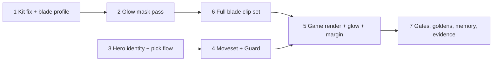

# feat: Blade fighter, a second playable hero

## Overview

Add a second playable hero to `games/nr`: a female blade fighter on the Universal Base Characters female body, with a generated sword that glows through an additive mask, in both player accents. Any player can join at any time and pick a hero; the first to confirm a hero gets it. She uses the brawler's controls with a longer sword combo, a dash strike, and Guard on the Grab button.

## Problem Frame

The combat slice has one hero, so co-op players differ only by accent and there is nothing to pick. The pipeline, sim and gates are proven for one hero. This plan adds a second character with a different feel without moving the brawler's no-title runs (see origin: docs/brainstorms/2026-10-25-blade-hero-requirements.md).

## Requirements Trace

- R1–R5. Join and pick at any time; first confirm gets the hero; solo plays either; disconnect keeps a confirmed hero; title return unlocks all.
- R6–R11. Sword combo with longer reach and duration; dash strike; Guard on held Grab; the two shared upgrade specials drawn with sword clips; jump attack on the brawler's placeholder jump frame; everything else as the brawler.
- R12–R16. Female body with a neon retexture and a silhouette distinct from the brawler at 128 px; sword in hand in every clip; additive blade glow in the player's accent; per-player accents on both heroes; HUD names each hero.
- R17–R18. A two-hero brawler-gate run on every host; blade look captures under one light, mid-combo beside a grunt, and guarding.

## Scope Boundaries

- No blade-specific upgrades, no grab or throw for her, no hand-keyed clips, no duplicate heroes, no new enemies, arenas or waves, no enemy behaviour against Guard (see origin).
- The polish backlog (knockback reactions on enemies, special HUD) stays out.
- No memory gate: memory is measured once and recorded.

## Context & Research

### Relevant Code and Patterns

- Sim: `games/nr/sim.c` `DEF[NR_ST_COUNT]` state table (rows parsed by `sim-check.mjs`, `enemies-check.mjs`, `fx-lib.mjs` in the exact `[NR_ST_X] = { { "name", t, s, a }` form); grunt and heavy own appended swing states. `hero_free` maps edges to HIT1, GRAB and DASH. `apply_hit` turns the victim only when `a->x != t->x`. `checksum_of` hashes `n[28]` per actor with four zero pads (24–27) and a full `ex[8]` (phase, phase_since, special_variant, pick_player, upgrade_done, joins, ignored_starts, return_title) only when `!auto_presence`.
- Join: `start_presses` calls `join_player` on any Start from a non-present pad; `join_player` sets present, calls `stand_at_edge`, adds lives and joins. `title_step` begins the fight on a Start from a player in `was_in` (currently `present`). `step_sim` returns before `start_presses` in clear and game over. `upgrade_step` returns after the first pick. `set_away` records away and releases holds only.
- Camera: `nr_sim_view_half(s, lane)` reads one `nr_view.allowance` (main.c `CAMERA_ALLOWANCE` 1.2), called by `stand_at_edge`, `step_camera` and the leash loop.
- Input: `nr_input.grab` is an edge only; `input_from_mask` and `read_input` in `games/nr/main.c` both build it.
- Render: `games/nr/main.c` `CHARS`, `VIS_*`, `char_of`, `resolve_visuals` (fails when a state's clip is missing), `build_scene` P2 accent pick, FX ring block (additive `basic`, depth write off, order −8). `games/nr/anim.c` `nr_atlas_variant`; `nr_atlas_load` requires one page.
- Pipeline: `tools/render/nr_render.py` `render_pass` sets one `view_layer.material_override` for the whole scene; rigid primitive attachments; `paletteOverride` recipes. `tools/render/post.mjs` packs 2048² pages (144 frames at a 160 cell). `tools/render/kits.mjs` `findFile` already refuses same-named files with different bytes.
- Memory: SDK `cmake/app.cmake` sets 128 MiB initial and 1 GiB maximum.

### Institutional Learnings

- macOS runner settings and the romdev frame-1 offset apply to every new script (`docs/solutions/developer-experience/cartwheel-runners-on-macos-env-2026-10-24.md`, `docs/solutions/logic-errors/romdev-loadmedia-consumes-frame-one-2026-10-24.md`).
- A new material state needs a program survey, committed tables, `cw.three.missing == 0` and a row-removal control (`docs/solutions/workflow-issues/cartwheel-programs-survey-out-of-tree-2026-10-24.md`).
- Atlas contract: binary alpha, matching colour/normal rects, accents as a second colour sheet over shared geometry (ADR-0002).
- Effects stay deterministic and outside the checksum; additive draws need explicit order and depth rules with a wrong-order control (ADR-0002).
- Captures assert phase and state before keeping the image; GL and WebGPU compare only against their own API.

## Prior-Art Survey

```json
{
  "schema_version": 2,
  "verdict": "extend",
  "scope": "games/**, deps/cartwheel-engine/games/**, /tmp/cartwheel-examples/games/**",
  "freshness": { "vcs_reference": "dc61d75" },
  "budget": { "max_search_passes": 6, "max_candidate_inspections": 12, "exhausted": false },
  "candidates": [
    { "path_or_symbol": "games/nr/sim.c:ENEMY[] and DEF[]", "description": "per-kind enemy numbers and per-state hitbox/timing rows; grunt and heavy own appended swing states", "disposition": "extend" },
    { "path_or_symbol": "games/nr/main.c:VIS_HERO/VIS_GRUNT/VIS_HEAVY, char_of, CHARS", "description": "per-character state-to-clip tables and atlas selection", "disposition": "extend" },
    { "path_or_symbol": "games/nr/anim.c:nr_atlas_variant", "description": "per-player accent as a second colour sheet over shared geometry and normals", "disposition": "reuse" },
    { "path_or_symbol": "games/nr/sim.c:join_player, start_presses, title_step, upgrade_step", "description": "per-player join and a per-player tap pick with lower-port tie break", "disposition": "extend" },
    { "path_or_symbol": "games/nr/main.c:bot_menu and games/nr/ui.c:draw_title, draw_tag", "description": "scripted menu joins, title panels, HUD tags", "disposition": "extend" },
    { "path_or_symbol": "games/nr/sim.h:nr_input.special_alt", "description": "the only held-button input; no held defensive state exists", "disposition": "insufficient", "insufficiency_reason": "Guard needs a held Grab field and new states" },
    { "path_or_symbol": "/tmp/cartwheel-examples/games/bikemesa/main.c:players_tick", "description": "per-player select slots outside a checksummed sim", "disposition": "insufficient", "insufficiency_reason": "UI-layer state; a pattern reference only" }
  ]
}
```

## Key Technical Decisions

- **Hero identity:** a `hero` field on the actor (0 brawler, 1 blade) in an `n[]` pad slot, hashed for every actor. Brawler hashes hold because the slot stays 0. `ex[]` grows to hold select state (per-player selecting flag and cursor, lock mask), so every title-flow checksum moves. No-title (`NR_NO_TITLE`, auto-presence) runs stay byte-identical.
- **Moveset as appended states** (blade hits, dash strike, guard, guard flinch) in the existing `DEF` row format; existing state numbers and test parsers stay valid. `hero_free` picks the hero's entry states.
- **Held Grab:** `nr_input` gains a held-grab field built in both `input_from_mask` and `read_input`; the edge stays for the brawler.
- **Guard:** frontal means the attacker is on her facing side; an attacker at exactly her x counts as frontal. A frontal hit while guarding costs no HP, does not turn her, grants no invulnerability, and pushes her back (further for the heavy) into the guard flinch. A frontal hit during the flinch is blocked the same way while Grab is held and lands normally once Grab is released. The flinch returns to Guard while Grab is held, else to idle. A rear hit takes the normal `apply_hit`.
- **Pick flow:** Start from a pad that is not in opens selection with the cursor on the first free hero; tap moves it; Attack confirms. On confirm the player becomes present, gets lives, joins and spawns (at the title, or at the camera edge mid-fight), using the existing join rules for lives and targeting. A selecting player is not an actor and is never targeted. All confirms on a tick are handled in port order: a free hero locks, a taken hero is refused, so the lower port wins a same-hero tie and different heroes both lock. At the title only confirmed players begin the fight with Start. A player who disconnects while selecting is dropped; a confirmed player who disconnects keeps the hero. Start on the clear or game-over screen is refused and counted, like the existing ignored starts.
- **Camera margin per actor:** `nr_sim_view_half` takes the actor's allowance. The brawler and the enemies keep 1.2. The blade's allowance is provisional in Unit 4 and set in Unit 5 from her measured widest frame.
- **Glow:** a fourth sheet role from a mask pass that assigns materials per object: blade white, every other mesh black, so the hand still occludes it. In game an additive textured `basic` material on the blade's frame geometry, tinted by the player's accent, drawn after the actor with depth write off and a small offset toward the camera. A wrong-order control (glow before the actor) must fail.
- **Accents:** both heroes ship a P2 colour sheet via `nr_atlas_variant`; the glow mask is accent-neutral.
- **Memory:** the 64 MiB atlas budget is retired. Touched memory is measured once on GL and WebGPU carts and recorded in ADR-0002 and the evidence README.
- **Kit tool:** the same-basename error tells the user to stage one variant into a flat folder. No new flag.
- **Lanes:** the render lane (Units 1, 2, 6) and sim lane (Units 3, 4) each work in their own git worktree. The render lane writes only `tools/render/**`, `games/nr/assets/**` and its own pipeline tests; all `games/nr` code and game tests belong to the sim lane and Units 5 and 7.

## Open Questions

### Resolved During Planning

- Body: the Universal Base Characters [Standard] pack's `Superhero_Female_FullBody`, with `Eyebrows_Female`, `Hair_Buns` and `Hair_BuzzedFemale` from the head-bone variant (same variant as the male hair), downloaded from itch.io and pinned CC0 in 160b521. Mannequin_F is not needed.
- Confirm button: Attack. Same-x attacker: frontal. Start on clear or game over: refused and counted. Unconfirmed disconnect: dropped.

### Deferred to Implementation

- Which hand holds the sword across the sword clips, and the profile's `handScale` for her.
- Her cell size and pivot; widen only her atlas if the sword leaves the cell.
- Kit clips for her walk, hurt and knockdown, and sword clip segments for her two specials (from the clip audit).
- Starting values for combo reach and timing and Guard pushback.
- What a mid-fight joiner sees while selecting (a HUD tag with the cursor is the default).
- The glow offset value, and whether its program row differs between GL and WebGPU.

## High-Level Technical Design

> *This illustrates the intended approach and is directional guidance for review, not implementation specification. The implementing agent should treat it as context, not code to reproduce.*



## Implementation Units

- [ ] **Unit 1: Kit tool message and blade profile with first clips**

**Goal:** Clarify the same-basename pin error, add the blade profile with the generated sword and neon retexture, and render idle and walk in both accents.

**Requirements:** R12, R13, R15

**Dependencies:** none

**Files:**
- Modify: `tools/render/kits.mjs`, `tools/render/clip-targets.json`, `docs/evidence/combat-slice/clip-audit.md` (regenerated), `games/nr/assets/roots.txt`, `games/nr/assets/PROVENANCE.md`
- Create: `tools/render/profiles/blade.json`, `tools/render/recipes/blade.json`, `tools/render/recipes/blade-p2.json`, `games/nr/assets/atlases/blade.png|blade-n.png|blade.json|blade-p2.png`
- Test: `tools/render/tests/kits.mjs`, `tools/render/tests/blade-profile.mjs`

**Approach:**
- Sword is three primitives (handle, guard, blade) skinned rigidly to the hand bone the sword clips use; the blade is its own object so Unit 2 can mask it, and a palette key so the P2 recipe can recolour it.
- Count frames per clip for her full set and record whether one 2048 page holds them.

**Patterns to follow:** `tools/render/profiles/hero.json`, `recipes/hero-p2.json`, `tools/render/tests/hero-profile.mjs`.

**Test scenarios:**
- Error path: a `--from` folder with two differing files of the same basename fails naming both paths and the stage-one-variant step.
- Happy path: idle and walk render twice with identical sheet and manifest hashes.
- Happy path: `blade-p2` differs from `blade` only in accent and blade palette pixels; rects and normals are identical.
- Edge case: a frame leaving the cell fails naming the clip and frame.

**Verification:** blade idle and walk in both accents, pinned, with provenance; the clip audit lists the sword clips and her frame count against one page.

- [ ] **Unit 2: Glow mask pass**

**Goal:** Render a per-frame blade mask and pack it as a fourth sheet with the same rects.

**Requirements:** R14

**Dependencies:** Unit 1

**Files:**
- Modify: `tools/render/nr_render.py`, `tools/render/post.mjs`, `tools/render/recipe.schema.json`
- Create: `games/nr/assets/atlases/blade-glow.png`
- Test: `tools/render/tests/pipeline-roundtrip.mjs`, `tools/render/tests/glow-mask.mjs`

**Approach:**
- The mask pass assigns materials per object instead of one view-layer override: blade emissive white, every other mesh black, so occluders stay in place. `verifyRects` covers the glow role.

**Patterns to follow:** `normal_override_material`; the colour/normal role pairing in `post.mjs`.

**Test scenarios:**
- Happy path: every mask pixel lies inside the colour sheet's opaque pixels.
- Happy path: a frame where the hand crosses the blade masks the hand's pixels black.
- Happy path: brawler, grunt and heavy renders are byte-identical (no glow role requested).
- Error path: a glow rect differing from the colour rect fails naming the frame.

**Verification:** round-trip reproduces the glow sheet hash; existing atlases unchanged.

- [ ] **Unit 3: Hero identity and the pick flow**

**Goal:** Give actors a hero, add held Grab, and build join-and-pick at any time with locks and disconnect rules.

**Requirements:** R1–R5, R16

**Dependencies:** none

**Files:**
- Modify: `games/nr/sim.h`, `games/nr/sim.c`, `games/nr/main.c` (input, auto-presence hero assignment, `publish_sim`, `register_debug`, `fill_ui`), `games/nr/ui.h`, `games/nr/ui.c`, `games/nr/CMakeLists.txt` (blade-hero define for auto-presence builds)
- Test: `games/nr/tests/sim-check.mjs`, `games/nr/tests/ui-check.mjs`, `games/nr/tests/input-pick.json`

**Approach:**
- Classify every committed input script as no-title or title-flow and record the list in the evidence README; no-title goldens must not move.
- New debug fields: per-actor hero, per-player selecting and cursor, lock mask.

**Execution note:** Prove no-title runs byte-identical before touching any golden.

**Patterns to follow:** `upgrade_step` tap pick (without its early return); `ex[]` gating in `checksum_of`.

**Test scenarios:**
- Happy path: P2 confirms blade first; P1's confirm on blade is refused, brawler accepted.
- Edge case: both confirm blade on one tick; the lower port gets it. P1 brawler and P2 blade on one tick both lock.
- Edge case: P1 and P2 press Start with no confirm; no fight begins and nobody is present.
- Happy path: solo brawler mid-fight; a second pad selects while the fight runs, is not targetable and adds no lives, can confirm only blade, then spawns at the camera edge with join-rule lives.
- Edge case: a selecting player disconnects (title or mid-fight) and is dropped; a confirmed blade disconnects, a new pad cannot confirm blade, the blade returns on reconnect.
- Edge case: Start on clear and game over is refused and counted.
- Happy path: title return unlocks both heroes.
- Integration: every no-title script's final checksum equals its golden; a control that sets hero to 1 on a brawler moves the golden.

**Verification:** pick scenarios pass; no-title goldens unchanged.

- [ ] **Unit 4: Blade moveset and Guard**

**Goal:** Add her combo, dash strike and Guard as appended states, actor-aware camera margin with a provisional blade value, and teach the bot.

**Requirements:** R6–R11

**Dependencies:** Unit 3

**Files:**
- Modify: `games/nr/sim.h`, `games/nr/sim.c`, `games/nr/main.c` (bot, allowance per hero)
- Test: `games/nr/tests/sim-check.mjs`, `games/nr/tests/input-blade.json`

**Approach:**
- Block check runs before damage in the hit path; new event appended after the last event id. Specials and the jump attack reuse the shared states.
- `nr_sim_view_half` takes the actor's allowance; enemies and the brawler keep 1.2.

**Patterns to follow:** grunt/heavy swing states; `hero_free`; `end_state`.

**Test scenarios:**
- Happy path: the blade combo chains three hits on the brawler's chain rule; reach exceeds the brawler's; total duration is longer.
- Happy path: the dash strike hits every enemy along its path once.
- Happy path: guarding facing a grunt, the punch costs no HP, pushes her back, keeps her facing; a second grunt's rear hit inside the flinch lands and turns her.
- Happy path: the heavy's frontal hook costs no HP and pushes further than a grunt's punch.
- Edge case: an attacker at her exact x is blocked.
- Edge case: a frontal hit during the flinch with Grab held is blocked; with Grab released it lands, and the flinch ends in idle.
- Edge case: guarding ignores attack, jump and dash; move input turns her in place.
- Error path: a blocked hit grants no invulnerability (a rear hit one tick later lands).
- Integration: no-title goldens unchanged.

**Verification:** blade scenarios pass; no-title goldens unchanged.

- [ ] **Unit 5: Game render, glow overlay and her margin**

**Goal:** Draw the blade fighter in both accents with her clip table and glow, show heroes in the HUD, set her camera margin, and move the game tests the render lane could not touch.

**Requirements:** R10–R16

**Dependencies:** Units 4, 6

**Files:**
- Modify: `games/nr/main.c` (`CHARS`, `VIS_BLADE`, hero-aware character lookup, accent per actor, glow overlay, blade allowance), `games/nr/anim.c`, `games/nr/anim.h` (blade clip table, mask loader; lift the one-page limit if Unit 1 found her set exceeds a page), `games/nr/CMakeLists.txt`, `games/nr/programs/nr.txt`, `games/nr/programs/nr_gl.c`, `games/nr/programs/nr_wgpu.c`, `games/nr/tests/hero-variant-check.mjs`, `games/nr/tests/enemies-check.mjs`, `games/nr/tests/clips-check.mjs`, `games/nr/tests/depth-check.mjs`
- Test: `games/nr/tests/blade-clips-check.mjs`, `games/nr/tests/glow-check.mjs`

**Approach:**
- The glow follows the actor's frame geometry and flip, tinted by accent, drawn after the actor with the depth rule from Key Technical Decisions.
- The jump attack draws the brawler's placeholder jump frame from her own sheet.

**Patterns to follow:** the FX ring block; `nr_atlas_variant`; `build_scene` accent pick.

**Test scenarios:**
- Happy path: every blade state maps to a clip with at least 4 frames and pivots inside rects; P1 draws magenta accents and glow, P2 cyan.
- Error path: a control drawing the glow before the actor is rejected by `depth-check`.
- Integration: `cw.three.missing` is 0 on native and cart, WebGPU and GL, with the glow on screen; a row-removal control reports the missing state.
- Integration: no-title goldens unchanged with her allowance set.

**Verification:** both accents render, programs re-surveyed and committed, missing-state 0.

- [ ] **Unit 6: Full blade clip set**

**Goal:** Render every blade clip in both accents plus the glow mask.

**Requirements:** R6–R11, R13–R15

**Dependencies:** Unit 2

**Files:**
- Modify: `tools/render/profiles/blade.json`, `tools/render/recipes/blade*.json`, `games/nr/assets/atlases/blade*`, `games/nr/assets/PROVENANCE.md`, `docs/evidence/combat-slice/clip-audit.md`
- Test: `tools/render/tests/blade-profile.mjs`

**Test scenarios:**
- Happy path: each planned clip renders with its frame range from the audit; the record of her widest frame per clip is written for Unit 5.
- Edge case: the widest blade frame stays inside her cell.

**Verification:** all blade clips installed in both accents plus glow, with provenance.

- [ ] **Unit 7: Gates, goldens, memory and evidence**

**Goal:** Re-baseline title-flow runs, add the two-hero run, extend every gate, measure memory once, and capture the blade look set.

**Requirements:** R17, R18

**Dependencies:** Unit 5

**Files:**
- Modify: `games/nr/tests/brawler.mjs`, `games/nr/tests/goldens.json`, `games/nr/tests/gen-input-unit7.mjs`, regenerated title-flow `games/nr/tests/input-*.json`, `games/nr/tests/title-contrast-check.mjs`, `games/nr/tests/look-set.mjs`, `games/nr/tests/gen-input-look.mjs`, `games/nr/tests/reach-check.mjs`, `games/nr/tests/controls.mjs`, `games/nr/tests/romdev-*.mjs`, `tests/gates.json`, `docs/decisions/0002-render-pipeline-and-look.md`
- Create: `games/nr/tests/input-2p-blade.json`, `docs/evidence/blade-fighter/README.md`

**Approach:**
- Rewrite only title-flow goldens; new fields go into every whitelist copy.

**Test scenarios:**
- Integration: the two-hero run reaches clear with both alive on native, romdev GL, Chromium GL, Chromium WebGPU and romdev WebGPU, equal to native and the golden.
- Integration: no-title goldens unchanged.
- Happy path: blade captures (one light, mid-combo beside a grunt, guarding) in both accents, phase-asserted through the existing look-set controls, cart pixel-identical to native.

**Verification:** `gate.mjs` passes all entries; ADR-0002 records the retired budget and measured memory; the evidence README lists commands, logs and the look checklist.

## System-Wide Impact

- **Interaction graph:** the title, join, targeting, lives and leash paths gain hero and selection awareness; the bot drives both heroes.
- **State lifecycle risks:** a selecting player has no actor; locks survive a confirmed disconnect and clear on title return.
- **Unchanged invariants:** no-title checksums, the brawler's state numbers and 1.2 allowance, the arena block widening, the FX ring, and the existing atlases.

## Risks & Dependencies

| Risk | Mitigation |
|------|------------|
| Her clip set exceeds one 2048 page | Unit 1 counts frames; Unit 5 lifts the one-page limit if needed |
| Glow rows skipped in a cart | Survey with the glow on screen; row-removal control |
| Title-flow golden rewrites hide a brawler regression | No-title goldens stay fixed and are proven before any rewrite |
| Sword clips hold the sword in the other hand | Audit the hand across sword clips in Unit 1 before fixing the attachment |
| Parallel lanes break each other's gates | One worktree per lane; disjoint write scopes |

## Sources & References

- **Origin document:** docs/brainstorms/2026-10-25-blade-hero-requirements.md
- Combat-slice plan: docs/plans/2026-10-24-002-feat-combat-slice-plan.md
- ADR: docs/decisions/0002-render-pipeline-and-look.md
- Evidence: docs/evidence/combat-slice/README.md, docs/evidence/combat-slice/clip-audit.md
